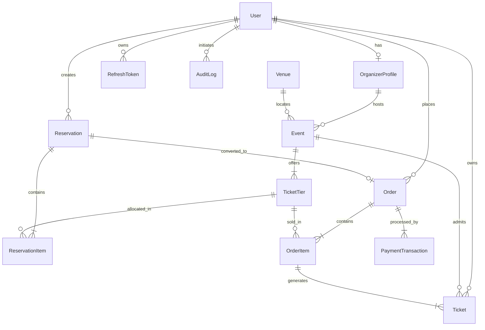

# Eventora Database Entity-Relationship Specification

## Overview
Eventora uses a normalized PostgreSQL schema designed for high-concurrency ticket reservations, strict tenant isolation, inventory hold reconciliation, and multi-role access control (Admin, Organizer, Attendee).

All monetary values are modeled as non-negative integer minor units (e.g. cents in USD or paise in INR) to eliminate floating-point arithmetic errors.

## Entities & Invariants

### 1. User & OrganizerProfile
- **User**: Central actor with email uniqueness constraint, bcrypt/argon2 hashed credentials, and role enums (`ADMIN`, `ORGANIZER`, `ATTENDEE`).
- **OrganizerProfile**: 1-to-1 extension of User when role is `ORGANIZER`. Maintains verification status and organization brand information. Multi-tenant isolation guarantees an organizer can only read/update their own events, tiers, attendee lists, and revenue.

### 2. Event & Venue
- **Venue**: Physical or hybrid venue holding maximum capacity.
- **Event**: Owned by `OrganizerProfile`. Holds `startAt`, `endAt`, `salesStartAt`, `salesCutoffAt`, and lifecycle status (`DRAFT`, `PUBLISHED`, `SUSPENDED`, `CANCELLED`).
- **Invariants**:
  - `endAt > startAt`
  - `salesCutoffAt <= startAt`
  - Draft and suspended events are excluded from public discovery queries.

### 3. TicketTier & Inventory Balance
- **TicketTier**: Represents tier levels (VIP, Premium, General Admission, Early Bird).
- **Core Inventory Invariant**:
  $$\text{totalQuantity} = \text{availableQuantity} + \text{reservedQuantity} + \text{soldQuantity}$$
  All three quantities must be $\ge 0$ at all times.
- Inventory reductions are prohibited if $\text{newTotal} < \text{reservedQuantity} + \text{soldQuantity}$.

### 4. Reservation & ReservationItem (10-Minute Hold)
- **Reservation**: Holds inventory temporarily for 10 minutes (`expiresAt = createdAt + 10m`).
- Transitions:
  $$\text{HELD} \longrightarrow \text{PAYMENT\_PENDING} \longrightarrow \text{CONFIRMED}$$
  $$\text{HELD} \longrightarrow \text{EXPIRED} \quad \text{or} \quad \text{RELEASED}$$
- Idempotency key prevents duplicate hold sessions for the same user cart attempt.

### 5. Order, OrderItem & PaymentTransaction
- **Order**: Created upon checkout initialization.
- **PaymentTransaction**: Tracks asynchronous mock payment status (`PENDING`, `PROCESSING`, `APPROVED`, `DECLINED`, `TIMED_OUT`).
- Enforces payment idempotency key: duplicate callbacks or retries with the same key return the recorded state rather than double-processing.

### 6. Ticket
- Generated on-demand upon payment confirmation: exactly 1 ticket per admission.
- Carries unique `ticketCode` (e.g. `EVT-8F92A-GA-01`) and cryptographically signed QR code payload.
- State: `VALID`, `CHECKED_IN`, `CANCELLED`.
